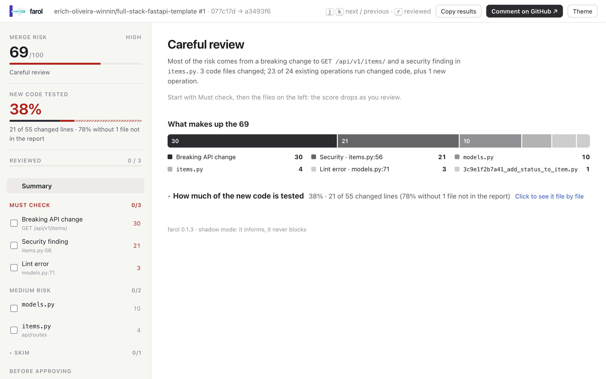
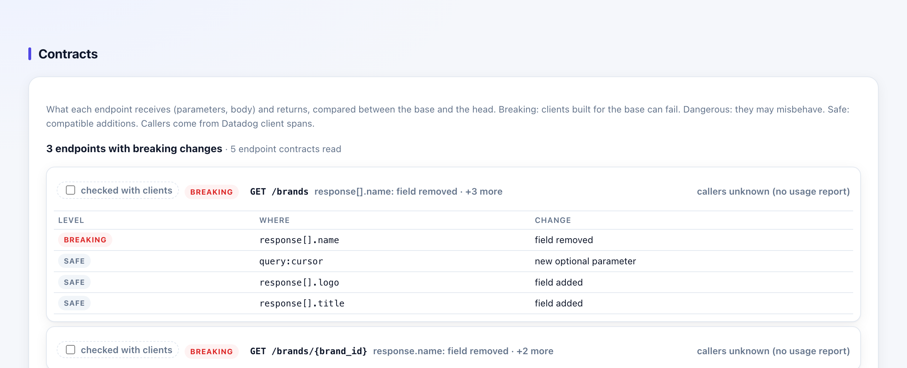

<p align="center">
  <picture>
    <source media="(prefers-color-scheme: dark)" srcset="assets/farol-horizontal-dark.svg">
    
  </picture>
</p>

<h3 align="center">Point your reviewers at the code that matters.</h3>

<p align="center">
  farol reads a pull request and tells the reviewer how much attention it needs, what it can break and where to look first.
</p>

<p align="center">
  <a href="LICENSE"></a>
  
  
  
</p>

---

Code is cheap now. An AI assistant writes a 1,500-line pull request in minutes, and a human still has to review it.
Reading every line with the same care does not scale, and skimming everything is how a one-line change to a shared
hook takes down forty pages.

**farol is not another AI reviewer, and it does not compete with them.** Keep your AI review bot: it is good at
commenting on the lines in the diff. What it cannot tell you reliably is what those lines *reach*: the forty pages
that render the hook, the clients of the endpoint whose response lost a field, the untested branch in the file every
route imports. farol answers that with static analysis (the compilers' own view of your code, not a model's guess),
so the human reviewer goes straight to what matters, and the AI's comments land where they count.

**farol** (Portuguese for *lighthouse*) does the triage before the reviewer opens the diff:

- **What does this change reach?** Every existing page, API operation, RPC method, job and script that runs the changed code, with the call chain to each.
- **How risky is the merge?** A verdict (*fast track*, *quick review*, *careful review*) and a 0–100 risk score from reach, diff coverage, security findings, contract breaks and dependency changes.
- **Where do I start?** The riskiest files first, with inline diffs, untested lines marked, and a checklist of what to try by hand.

It runs in your CI, comments on every PR and never blocks a merge. It **never executes your code** and never sends it
anywhere.

<p align="center">
  <picture>
    <source media="(prefers-color-scheme: dark)" srcset="docs/images/report-overview-dark.png">
    
  </picture>
</p>

## Live demo

**[See farol on a real pull request →](https://winnin.github.io/farol/demo/)**

The demo holds the reports farol produced in CI for a pull request on the
[FastAPI full-stack template](https://github.com/fastapi/full-stack-fastapi-template): a FastAPI backend and a React
frontend with TanStack Router. The pull request adds a status to items and an Insights page, with the kind of problems
a reviewer should catch: a breaking API change, SQL built with an f-string, a shared component without tests.

- [Backend report](https://winnin.github.io/farol/demo/backend.html): ⚠ careful review, a breaking contract change and a high-severity security finding.
- [Frontend report](https://winnin.github.io/farol/demo/frontend.html): ⚠ careful review, a new page and the existing pages a shared component reaches.

The reports are interactive: mark files as reviewed, mark a page as behind a feature flag, open the inline diffs,
follow the test plan and copy the review record from the Result tab. They are the same files the pull request's
comments link to ([the pull request](https://github.com/erich-oliveira-winnin/full-stack-fastapi-template/pull/1)); the
copies live in [`docs/demo/`](docs/demo/).

## farol and AI code review

| | AI review agents | farol |
|---|---|---|
| **Reads** | the diff, and whatever context fits in the prompt | the whole program at the base and the head, with the compilers (TypeScript type checker, `go/types`, Python `ast`) |
| **Tells you** | what may be wrong in these lines | what these lines reach, how risky the merge is, and where to look first |
| **Answers are** | probabilistic: worded differently on every run | deterministic: the same PR gives the same report, and every claim comes with its call chain |
| **When unsure** | may sound confident anyway | says `unknown` and asks for a careful review |
| **Runs** | a model, usually a hosted service | locally or in your CI: it never executes your code and never sends it anywhere |

Use both. Let the agent comment on style, naming and local bugs; use farol to decide how much human attention the PR
needs, which files deserve it, which pages and endpoints to test by hand, and which contract changes need their clients
checked. The agent's review is not enough exactly when a small change has a large reach, and that is what farol shows.

## Why farol

- **Review attention goes where the risk is.** A 40-file PR usually has two or three files that can actually hurt. farol ranks them, so the reviewer reads those closely and skims the rest with a clear conscience.
- **It follows the code, not the file names.** farol builds a declaration graph with the real compilers (the TypeScript type checker, `go/types`, Python's `ast`). A change to `formatPrice` lists the twelve pages that render it, not "1 file changed".
- **Contract breaks are caught before clients are.** Removed response fields, new required parameters, changed types in GraphQL, FastAPI, Go handlers and gRPC, with the services that call each endpoint.
- **Review the whole PR, or just what changed since your last look.** Every push gets two reports: the full pull request, and only the commits since the previous push. After a round of fixes, the reviewer checks the new commits instead of starting over.
- **It uses what your CI already has.** Coverage, lint, security and audit reports become diff coverage and findings on the changed lines. Nothing runs twice.
- **Fail closed.** When farol cannot read part of a change, it says so (`unknown`) and asks for a careful review. It never calls something safe because it did not understand it.
- **Built for the human in the loop.** Mark files as reviewed, mark pages as behind a feature flag, check off findings, and paste the result back in the PR as a record of what was reviewed.

## Contents

- [Live demo](#live-demo)
- [farol and AI code review](#farol-and-ai-code-review)
- [Get started](#get-started)
- [Recipes](#recipes): [React Router](#react-frontend-react-router) · [Next.js](#nextjs) · [TanStack Router](#tanstack-router) · [TypeScript API](#typescript-api-graphql-or-rest) · [Go](#go-service) · [Python](#python-service) · [Datadog](#add-datadog-traffic-and-errors)
- [What is supported](#what-is-supported)
- [Reading the review](#reading-the-review)
- [How it works](#how-it-works) · [Security](#security-and-privacy) · [Limitations](#limitations) · [FAQ](#faq)
- [Reference](docs/reference.md) (every command, option and configuration key)

## Get started

You need **Node.js 22+** and **git** (plus `go` for Go projects, `python3` 3.11+ for Python ones). Nothing to
install: run farol with `npx @winninjs/farol`.

**1. Describe your project** in a `farol.config.json` at its root. One line is enough to start; pick your stack:

| Your project | `farol.config.json` | Full recipe |
|---|---|---|
| React app with React Router | `{ "routes": { "file": "src/routes.tsx" } }` (the file that builds the route table) | [React Router](#react-frontend-react-router) |
| Next.js app (Pages or App Router) | `{ "routes": { "adapter": "next" } }` | [Next.js](#nextjs) |
| React app with TanStack Router | `{ "routes": { "adapter": "tanstack-router", "dir": "src/routes" } }` | [TanStack Router](#tanstack-router) |
| TypeScript API (GraphQL, REST) | `{ "surface": "backend" }` | [TypeScript API](#typescript-api-graphql-or-rest) |
| Go service | `{ "language": "go", "surface": "backend" }` | [Go](#go-service) |
| Python service (FastAPI, Flask, Django, Celery…) | `{ "language": "python", "surface": "backend" }` | [Python](#python-service) |

**2. Check what farol sees:** the pages, endpoints, jobs and scripts it found.

```sh
npx @winninjs/farol routes
```

**3. Analyze a branch** against its target and open the report.

```sh
npx @winninjs/farol analyze --base origin/main --head HEAD --out farol.json
npx @winninjs/farol html --in farol.json --out farol.html && open farol.html     # xdg-open on Linux
```

### Example: a React app with React Router

```sh
cd path/to/your/react-app
echo '{ "routes": { "file": "src/routes.tsx" } }' > farol.config.json

npx @winninjs/farol routes                                        # lists your pages: "/", "/products", "/settings"…
git checkout my-feature-branch
npx @winninjs/farol analyze --base origin/main --head HEAD --out farol.json
npx @winninjs/farol html --in farol.json --out farol.html && open farol.html
```

The report already shows the verdict, the score, the files to start with, the pages the change reaches and what to
test by hand. **Next steps:** add your coverage, lint and audit reports and run farol on every PR with the
[recipe for your stack](#recipes). Every option is in the [reference](docs/reference.md) and, per stack, in
[examples/README.md](examples/README.md).

> Running it often? `npm install --global @winninjs/farol` gives you a plain `farol` command.

## Recipes

Each recipe has three parts: the `farol.config.json` to commit, the reports to produce, and the GitHub Actions
workflow. The workflows in [`examples/`](examples/) are complete and share one shape:

1. **`tests`** runs your tests, linter and audit and keeps the reports. It runs the PR's code, so it has no secrets and a read-only token. If you already have a test job, keep it and add its upload step.
2. **`farol`** runs after it (pass or fail), reads git and the reports, and posts a **new comment on every push** with a link that opens the HTML report in the browser, plus a second report with only the commits since the previous push. It never runs the PR's code.
3. Drafts are skipped, fork PRs get no comment (their token is read-only), and every farol step is `continue-on-error`.

Pin the action to a commit once it works for you: `winnin/farol/action@<sha> # main as of <date>`.

[`examples/README.md`](examples/README.md) goes deeper for each stack: every configuration key, CLI parameter and
action input, and how to check a setup.

### React frontend (React Router)

React Router route tables (object and JSX forms, lazy routes, split route modules), reach per declaration.

```json
{
  "routes": { "file": "src/routes.tsx" },
  "roles": { "global": ["src/main.tsx", "src/App.tsx", "src/styles/global.css", "package.json", "vite.config.ts"] }
}
```

```sh
npx vitest run --coverage.enabled --coverage.reporter=json --coverage.reportsDirectory=reports/coverage
npx eslint -f json -o reports/eslint.json <changed files>
npm audit --json > reports/audit.json                     # or pnpm audit --json

npx @winninjs/farol analyze --base origin/main --head HEAD \
  --coverage reports/coverage/coverage-final.json --eslint reports/eslint.json --audit reports/audit.json --out farol.json
```

**CI:** copy [`examples/workflow.yml`](examples/workflow.yml) to `.github/workflows/farol.yml`.

Set `coverage.include: ['src/**/*.{ts,tsx}']` in the Vitest config so files no test loads are reported as untested.
Split route trees go in `routes.extraFiles`; a fuller config is in [examples/farol.config.json](examples/farol.config.json).

### Next.js

Pages Router and App Router: every page, API route, layout, `_app`/`_document` and middleware, read from the file
names. Dynamic segments (`[id]`), catch-alls, route groups and parallel slots are understood.

```json
{
  "routes": { "adapter": "next" },
  "roles": { "global": ["next.config.*", "package.json"] }
}
```

`pages/` and `app/` are found in the project or in its `src/`; set `"dir"` when they live elsewhere. Reports and CI
are the same as for [React Router](#react-frontend-react-router) (Jest or Vitest coverage, ESLint, audit). In a
monorepo whose tsconfig extends a workspace package (`"extends": "tsconfig/nextjs.json"`), install dependencies
before analyzing, so the package is in `node_modules`.

### TanStack Router

File-based routing: every module calling `createFileRoute('<id>')` under the routes directory, with the root route,
pathless layouts (`_app`) and parent routes as layouts of their children.

```json
{ "routes": { "adapter": "tanstack-router", "dir": "src/routes" } }
```

Reports and CI are the same as for [React Router](#react-frontend-react-router).

### TypeScript API (GraphQL or REST)

GraphQL root operations (schema files and `gql` templates, per resolver) and Fastify/Express-style REST endpoints.

```json
{
  "surface": "backend",
  "backend": { "graphql": true, "rest": true },
  "roles": { "global": ["package.json", "src/app.ts"] }
}
```

Reports and CI are the same as for [React Router](#react-frontend-react-router): [`examples/workflow.yml`](examples/workflow.yml). If
resolvers reach data through an injected context (`ctx.loaders.Brand.byId()`), tell farol where the providers live:
`"backend": { "context": { "loaders": ["src/modules/*/loaders/index.ts"] } }`.

### Go service

chi, gin, echo and net/http routes, gRPC service methods and `main` binaries, reach per declaration with interface
calls resolved to their implementations.

```json
{ "language": "go", "surface": "backend" }
```

```sh
go test -coverpkg=./... -coverprofile=reports/cover.out ./...
golangci-lint run --output.json.path=reports/golangci.json --issues-exit-code=0 ./...   # enable gosec
govulncheck -json ./... > reports/govulncheck.json

npx @winninjs/farol analyze --base origin/main --head HEAD \
  --coverage reports/cover.out --eslint reports/golangci.json --audit reports/govulncheck.json --out farol.json
```

**CI:** copy [`examples/workflow-go.yml`](examples/workflow-go.yml). farol reads modules offline, so the workflow runs
`go mod download` for the base and the head first.

### Python service

FastAPI and Flask routes (routers, blueprints, prefixes), Django URLs, MCP tools/resources/prompts, Celery tasks,
Temporal workflows and activities, Prefect flows and `__main__` scripts. farol parses your code; it never imports it.

```json
{ "language": "python", "surface": "backend", "python": { "roots": ["src", "."] } }
```

```sh
pytest --cov=src --cov-report=json:reports/coverage.json
ruff check --output-format json --extend-select S --exit-zero . > reports/ruff.json    # S = flake8-bandit
pip-audit --format json -o reports/pip-audit.json

npx @winninjs/farol analyze --base origin/main --head HEAD \
  --coverage reports/coverage.json --eslint reports/ruff.json --audit reports/pip-audit.json --out farol.json
```

**CI:** copy [`examples/workflow-python.yml`](examples/workflow-python.yml) (uses `uv`; swap in your installer).

### Add Datadog traffic and errors

Optional, and information only: it never changes the score. With it the report shows how much traffic each affected
page or operation gets, its **distinct production errors** (linked to Datadog), the changed files that already throw
errors, and the services that call each changed endpoint.

```json
{
  "datadog": {
    "env": "prod",
    "rum": { "applicationId": "<RUM application id>" },
    "apm": { "service": "orders-api", "operations": ["fastapi.request"] }
  }
}
```

```sh
DD_API_KEY=… DD_APP_KEY=… npx @winninjs/farol usage --out usage.json      # last 14 days
npx @winninjs/farol analyze … --usage usage.json
```

**CI:** the example workflows have a `farol-usage` job: set the `DD_API_KEY` and `DD_APP_KEY` secrets and the
repository variable `FAROL_DATADOG=true`. It reads Datadog once a day and never sees the PR's code. Keys, scopes and
matching rules are in the [reference](docs/reference.md#traffic-and-errors-from-datadog).

## What is supported

| | TypeScript / React frontends | TypeScript / JavaScript backends | Go | Python |
|---|---|---|---|---|
| **Entry points** | React Router route tables (object and JSX forms, lazy routes, split route modules); Next.js Pages and App Router (pages, API routes, layouts, middleware); TanStack Router file-based routes | GraphQL root operations (schema files and `gql` templates) and REST endpoints (Fastify/Express style) | chi, gin, echo and net/http routes; gRPC service methods; `main` binaries | FastAPI and Flask routes (routers, blueprints, prefixes); Django URLs; MCP tools, resources and prompts; Celery tasks; Temporal workflows and activities; Prefect flows; `__main__` scripts |
| **Reach precision** | per declaration (TypeScript type checker) | per module, per resolver for GraphQL | per declaration (`go/types`, interface calls resolved to implementations) | per declaration (Python `ast` with local type inference) |
| **Contract changes** | — | GraphQL schema (breaking / dangerous / safe) | Handler request and response types (net/http, chi, gin, echo); gRPC messages | FastAPI parameters, body, response and Pydantic models |
| **Dependencies** | `package.json` + npm/pnpm/yarn/bun lockfiles | same | `go.mod` + `go.sum` | `pyproject.toml` (PEP 621, extras, groups, uv, Poetry), `requirements.txt` + `uv.lock`/`poetry.lock`/`Pipfile.lock` |
| **Diff coverage** | Istanbul `coverage-final.json` (Vitest, Jest) | same | `go test -coverprofile` | coverage.py JSON (`pytest --cov`) |
| **Lint** | `eslint -f json` | same | golangci-lint JSON | ruff JSON |
| **Security** | built-in rules (XSS sinks, `eval`, hard-coded secrets, `javascript:` URLs…) | same | gosec (through golangci-lint) | flake8-bandit (ruff `S` rules) |
| **Vulnerabilities** | `npm audit --json`, `pnpm audit --json` | same | `govulncheck -json` | `pip-audit --format json` |
| **Suppressions** | `eslint-disable`, `@ts-ignore`, `@ts-expect-error`, `as any`… | same | `//nolint`, `//lint:ignore`, `#nosec` | `# noqa`, `# type: ignore`, `# nosec`, `# pragma: no cover`… |
| **Traffic and errors** (optional) | Datadog RUM page views and errors | Datadog APM requests, error spans and callers | same | same |

In every language: environment, infrastructure and CI files (`.env*`, Dockerfiles, compose, CI pipelines, helm, k8s,
terraform…) in a section of their own; incremental analysis since any commit (`--since`); suggested reviewers from
git blame and CODEOWNERS; reports as a GitHub comment, Markdown or a single-file HTML page.

## Reading the review

farol produces two things: a **PR comment** with the verdict, the top files and a test checklist, and a
**single-file HTML report** (linked from the comment) where the review happens. Here is what each part is for and how
to use it.

### Verdict and merge risk score

What it tells you is how much of your time the PR deserves.

| Verdict | Means | What to do |
|---|---|---|
| ✓ **Fast track** | Only new code, tests or low-risk changes. | Skim the diff and approve. |
| ◐ **Quick review** | Existing code changed in a contained way, or a weaker signal (low coverage, lint errors, a config file). | Check the *Start here* files, then approve. |
| ⚠ **Careful review** | Wide or silent breakage is possible: a score of 60+, a breaking contract change, a high-severity finding, an untested central file, or code farol could not read. | Read the *Start here* files line by line and test what they reach. |

The **score** (0–100) is the chance that at least one risky item breaks something. Expand *What adds to it* to see
each item and its points: the files by reach × untested share, findings, contract changes, dependencies. The verdict
always comes with its reasons; read them before the diff.

### Start here

The changed code files, riskiest first. Each row shows how many existing pages or operations run the file, its diff
coverage, its findings and its own risk points; with Datadog, also its traffic and production errors. Open the inline
diff: added lines no test runs are marked **○**, lines with findings **⚠**.

**How to use it:** review top-down and tick **Mark as reviewed** on each file. The score drops as you go, so you
always know how much risk is left. Below it come the low-risk files to skim, environment/infrastructure/CI files
(check their values per environment), and files that need no review (docs, lockfiles, tests).

### Behind a feature flag

On every page or operation row, and in a panel at the top: mark an entry point that is entirely behind a flag. Files
that **only** flagged entry points use leave the review, labeled *behind a flag* rather than reviewed. Use it for
work-in-progress features shipped dark, so the remaining score reflects what users will actually hit.

### Pages / Operations

Every new and affected entry point, as a list or a tree by module. Opening one draws **how** the change reaches it,
file by file. With Datadog each one shows its traffic share and its distinct errors, busiest first. **Use it** to
judge blast radius: a change reaching 3 rarely used admin pages is not the same as one reaching the checkout.

### Contracts (backends)

Each endpoint whose request or response shape changed, as **breaking** (clients built for the base can fail),
**dangerous** (they may misbehave) or **safe** (compatible additions), with the exact field and the calling services
from Datadog. **Use it** to confirm every breaking change is intended and its clients are updated, then tick
*checked with clients*.

<p align="center"></p>

### Security, Dependencies, Coverage

The evidence behind the score: security findings on the changed lines (with a *checked* box each), added or bumped
dependencies with known vulnerabilities, and diff coverage per file. A report that was not given shows as
**not verified**, never as passing.

### Test plan

The new and affected pages or operations to try by hand, new ones first, then by the risk of the file that reaches
them. The PR comment has it as a task list. **Use it** when you run the branch locally or on a preview environment.
It follows your review: once every changed file behind an item is marked as reviewed, the item is marked too
(✓ files reviewed), or 🚩 behind a flag. Its own checkbox, for the manual test, stays yours to tick.

### Reviewers

Who should review: the people who wrote the code this PR changes (git blame, weighted by each file's risk), plus
CODEOWNERS. The PR's own authors and bots are left out, and inactive people are labeled. **Use it** to request the
person who knows the riskiest file, not just whoever is free.

### Result

A Markdown record of the review: the initial verdict and score, the score left now, the flagged entry points, the
reviewed files, and the checked findings and contract changes. **Copy as Markdown** and paste it in the PR as your
review comment, so the next person knows what was looked at.

### Since the last push

After a push to an open PR, the comment carries a second report with only the commits since the previous push
(`analyze --since <sha>`; after a force-push, from its merge-base). Its verdict, score and *Start here* cover just
those changes. **Use it** for the second round of a review: check that the fixes do what was asked and nothing
else, then go back to the full report only if the new commits reach somewhere new.

### Class and reasons

Kept in *Details* and a collapsed block of the comment, so reviewers form their own opinion first:
`isolated` (only adds), `touches-existing` (existing code changed), `global` (a global file, manifest or critical
dependency) and `unknown` (part of the change could not be read: never safe). Every reason code is in
[docs/reasons.md](docs/reasons.md).

## How it works

1. **Diff** the merge-base and the head, detecting renames and ignoring whitespace-only and trailing-comma lines.
2. **Read both trees without running anything**: the TypeScript compiler API, `go list` + `go/types` (offline), Python `ast`. From them, the entry points and a graph of which declaration uses which.
3. **Compare declarations** by a hash of their code, so comments and formatting never count. New declarations and entry points are additive.
4. **Reach**: from each changed declaration to every entry point that runs it, keeping the shortest chain.
5. **Classify, weigh and plan**: class, score, verdict, files to start with, test checklist.

On 662 past commits of four repositories, *fast track* had **0 problems in 56 commits** and the score's AUC was
**0.72–0.83**; run [`farol calibrate`](docs/reference.md#calibrating-the-score-on-your-history) on your own history.
The details per language are in [docs/how-it-works.md](docs/how-it-works.md), and the reasons behind every choice in
[docs/DECISIONS.md](docs/DECISIONS.md).

## Security and privacy

- `analyze` **never executes code** of the analyzed repository and **never uses the network**. The Go and Python helpers use only their standard libraries and only parse.
- Only `comment` (GitHub API) and `usage` (Datadog API) talk to the network. Error messages are not copied from Datadog, only error types.
- In CI the job that runs your code has no secrets and no write token; the job that comments never runs your code.
- Shadow mode: farol informs, it never approves, requests changes or fails a check.

## Limitations

- Static reading: values built at runtime are invisible (computed route paths, `getattr`, `importlib`, DI containers, registries filled in loops). When an entry point cannot be read, the PR is `unknown`; when a call cannot be resolved, farol assumes it reaches more, never less.
- TypeScript frontends: React Router, Next.js and TanStack Router (file-based) only: no code-based TanStack route trees, Remix/React Router file conventions, Vue or Svelte. JavaScript files, renamed files and TypeScript backends use module-level reach.
- Go: route prefixes from middleware stacks other than chi/gin/echo groups are not applied, and project types that wrap a router with their own registration API (Gitea's `web.Router`) are not read. Python: Django REST Framework routers are not read.
- The score and verdict thresholds are heuristics checked on a few repositories. Calibrate them on yours.

## FAQ

**We already have an AI reviewer. Why add farol?** They answer different questions. The agent comments on the lines
in the diff; farol tells you what those lines reach and how much review the PR needs, from static analysis of the whole
program. Run both: farol's comment and report sit next to the agent's, and neither blocks the merge.

**Will it slow down CI?** No. farol runs after your tests and reuses their reports. The analysis takes about 3 s for
a 300-file Python service, 8–10 s for a large TypeScript monorepo or a Go service with a cold cache, and under a
second for the base when its helper output is cached.

**Can I use it outside GitHub?** Yes. `analyze`, `html` and `report` work anywhere; only `comment` is
GitHub-specific. Post the output of `npx @winninjs/farol report` with your platform's API.

**The report says "not verified".** That report was not given, or the path is wrong. Paths given to `analyze` are
relative to the current directory; paths in `farol.config.json` are relative to the project.

**A page I changed is not listed.** Run `npx @winninjs/farol routes` to see the entry points farol reads, and
`npx @winninjs/farol impact <file>`
to see what reaches a file. Unreadable route constructs are listed under diagnostics.

**Go: "farol reads Go modules offline: run go mod download".** The module cache lacks a dependency of the base or the
head. Run `go mod download` for both before analyzing.

**Monorepo?** Point `--cwd` at the app. Paths stay relative to the repository root, and changes in apps the project
does not use are listed as outside it.

## Contributing

Contributions are welcome: route adapters, frameworks, languages, report formats and better heuristics. See
[CONTRIBUTING.md](CONTRIBUTING.md) for the setup, the architecture and the conventions, and
[SECURITY.md](SECURITY.md) to report a vulnerability.

## License

[MIT](LICENSE) © 2026 Winnin
